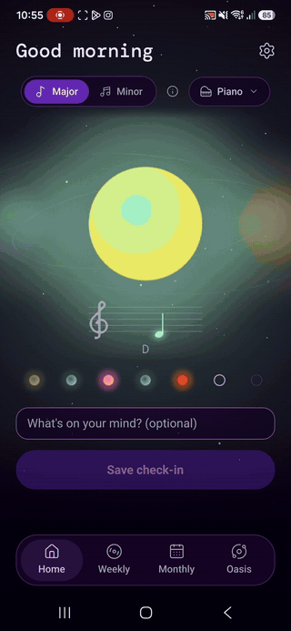
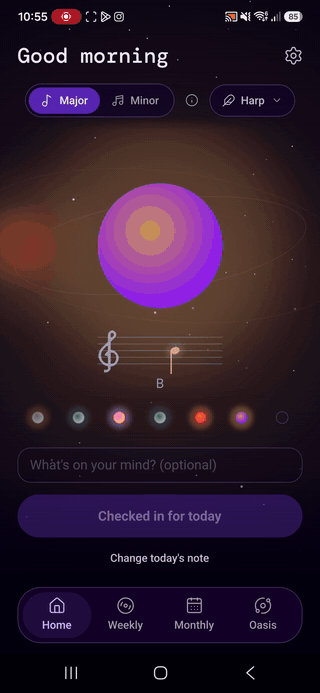
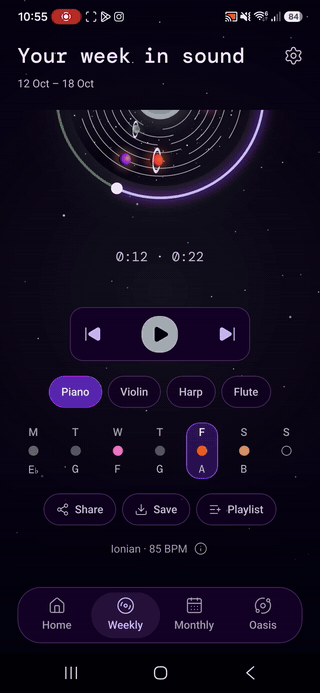
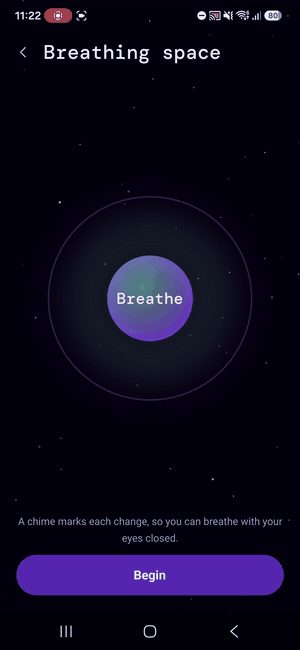
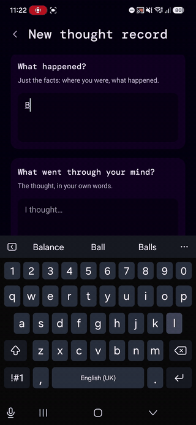
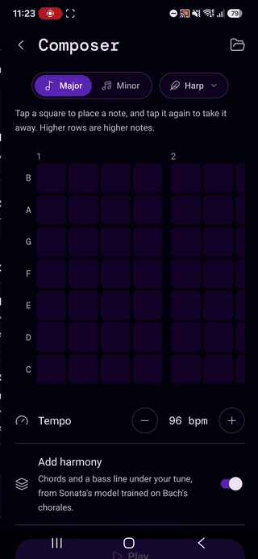
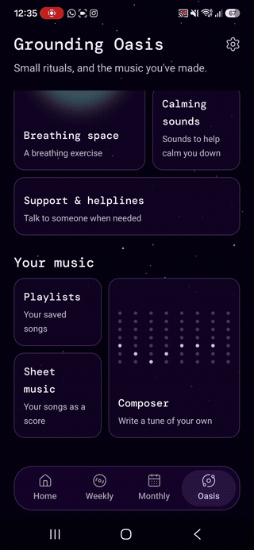

<!-- Images are hosted as GitHub attachments (exported from the Figma file); the GIFs live in docs/readme/. -->

<p align="center">
  
</p>

<p align="center">
  <a href="#download"></a>
  <a href="#on-an-iphone"></a>
  
  
  
  
  
</p>

<p align="center">
  <b>Sonata</b> turns a daily check-in into music. Each day you pick one glowing orb by its colour and sound.<br>
  At the end of the week, an AI on your phone, trained on Bach's chorales, writes those seven notes into a song.
</p>

<p align="center">
  <a href="#download">Download</a> ·
  <a href="#what-it-does">What it does</a> ·
  <a href="#how-the-song-is-written">The AI</a> ·
  <a href="#private-by-design">Privacy</a> ·
  <a href="#design">Design</a> ·
  <a href="#run-it-yourself">Run it yourself</a>
</p>


## Contents

- [Download](#download)
  - [On an Android phone](#on-an-android-phone)
  - [On an iPhone](#on-an-iphone)
- [What it does](#what-it-does)
- [How the song is written](#how-the-song-is-written)
- [Private by design](#private-by-design)
- [Design](#design)
- [Run it yourself](#run-it-yourself)
- [Project structure](#project-structure)
- [Testing](#testing)
- [Credits](#credits)
- [Licence](#licence)

## Download

### On an Android phone

Sonata runs on Android 7.0 or newer. It isn't on the Play Store, so you install it straight from the APK file.

1. **Download the APK.** On your phone, open the [latest release](https://github.com/corbyn-jpg/sonata/releases/latest) and tap **`Sonata.apk`**.
2. **Allow the install.** Android asks before installing an app from outside the Play Store. Tap **Settings**, turn on **Allow from this source** for your browser (or Files), then go back.
3. **Install.** Tap **Install**. If Play Protect says it doesn't recognise the developer, tap **More details**, then **Install anyway**. This happens for any app that isn't from the Play Store.
4. **Open Sonata.** The short introduction explains the rest. There's no account to make.

> [!NOTE]
> Updates arrive by themselves. When there's a new version, Sonata downloads it in the background the next time you open it and switches to it the time after, so there's nothing to reinstall.

### On an iPhone

<!-- TODO: choose one option below and delete the others. -->

iPhones don't install apps from outside the App Store, so there are other ways to try Sonata:

| Option | What you get |
| --- | --- |
| **[Try it in the browser](#)** (Appetize) | The real app, running in Safari on your iPhone. Sessions last a few minutes. |
| **[Click through the prototype](https://www.figma.com/proto/HwpksPZs1OY5Svz1uletJL/Ux-Term-4?node-id=119-149&starting-point-node-id=119-149)** (Figma) | Every screen, with working buttons, sheets and animations. |
| **[Watch the walkthrough](#)** (video) | The whole app, start to finish, in a few minutes. |


## What it does

<p align="center">
  
</p>

### Your days, in music

Each day starts with one orb. Swipe until an orb sounds like today, then tap it: each one plays its own chord, major or minor, on piano, violin, harp or flute. There are no words to choose and no scales to rate.

At the end of the week, Sonata writes the seven notes into a melody, paints a record for it from the week's colours and plays it on a spinning disc. A month's weeks join into one longer piece on a moon-phase record.

<table>
  <tr>
    <td align="center"><br><sub>A check-in</sub></td>
    <td align="center"><br><sub>The week's song</sub></td>
    <td align="center"><br><sub>The month</sub></td>
  </tr>
</table>

<p align="center"></p>

### Small rituals, when you need them

The Grounding Oasis holds small, opt-in rituals:

- **Breathing space:** in for four and out for six, paced by a glowing orb, with a chime at each change so you can follow it with your eyes closed.
- **Thought record:** write down a thought that's weighing on you, notice whether it follows a pattern, and find a kinder way to see it.
- **Calming sounds:** rain, waves, birdsong and more, one at a time on a loop.
- **Support and helplines:** South African lines that call or text in one tap.

If a week has been heavy, Sonata quietly offers a moment to breathe. It never diagnoses and never asks again that week.

<table>
  <tr>
    <td align="center"><br><sub>Breathing space</sub></td>
    <td align="center"><br><sub>Thought record</sub></td>
  </tr>
</table>

<p align="center"></p>

### Write a tune of your own

The Composer is a grid of seven note rows and sixteen beats. Tap squares to write a tune, and Sonata can add chords and a bass line underneath it. Any week, month or saved piece also opens as a lead sheet, ready to export as a PDF or as MusicXML for MuseScore, Sibelius or Dorico.

<table>
  <tr>
    <td align="center"><br><sub>The Composer</sub></td>
    <td align="center"><br><sub>Sheet music</sub></td>
  </tr>
</table>

<p align="center"></p>

<details>
<summary><b>Everything else</b></summary>

- Playlists of your weeks and pieces, played in order.
- Share a week's song with a message, or save it to your phone.
- A daily reminder at a time you choose.
- **Feel notes:** every note has its own vibration, for anyone who can't hear the app. More pulses mean a higher note.
- Export everything you've logged as a PDF, back it up to a passphrase-locked file, or delete it all.

</details>


## How the song is written

<p align="center">
  
</p>

Sonata's AI is neuro-symbolic. It uses rules where music theory is clear (choosing the mode, the final cadence, voicing) and learned models where taste matters:

- **Chords:** a Markov chain learned from the JSB Chorales dataset, with separate odds for major and minor keys.
- **Melody:** a small GRU recurrent network (48 hidden units, about 16,000 weights) that picks each passing note. Rules keep its choices in the scale, in range, and able to reach the next day's note.

The training code is in `scripts/train/`. It was written from scratch in TypeScript, including backpropagation through time, and every gradient is checked in a test. It's seeded, so `npm run train:model` gives the same model every time.

Measured on the 77 test chorales the model never saw (perplexity, lower is better):

| | Baseline | Sonata |
| --- | --- | --- |
| Chords | 5.77 (hand-written rules) | **4.60** (learned chain) |
| Melody | 4.71 (Markov chain) | **2.43** (GRU) |
| Next melody note, top guess right | | **72%** |

The GRU also sees the harmony, which the baselines don't.

Nothing runs in the cloud. The app ships only the learned numbers, Bach's music is public domain, and no personal data is used for training.


## Private by design

<p align="center">
  
</p>

- Everything you log (check-ins, thought records, playlists, pieces) is sealed with **AES-256-GCM** on the phone, using a fresh IV for each record and a key that never leaves the phone.
- It's saved on the phone first, so Sonata works offline. The backup in Firestore only ever receives ciphertext, plus a 1–10 number used for sorting.
- Sign-in is anonymous: no email, no name, no account.
- No analytics, no trackers, and the app never asks for the microphone.


## Design

- **Figma:** [wireframes, annotated wireframes, mockups and the clickable prototype](https://www.figma.com/design/HwpksPZs1OY5Svz1uletJL/Ux-Term-4).
- **Type:** DM Mono for headings and Roboto for everything else.
- **Colour:** a violet-black night sky. Colour comes from the orbs: fourteen two-tone gradients, one for each note in major and minor.


## Run it yourself

You'll need [Node 22](https://nodejs.org), an Android phone or emulator, and a free [Expo](https://expo.dev) account. Sonata uses native modules (Skia, audio, encryption, sharing), so it runs in a **development build**, not Expo Go.

```bash
git clone https://github.com/corbyn-jpg/sonata.git
cd sonata
npm install
```

Make and install a development build once, either in the cloud:

```bash
npx eas-cli@latest build --profile development --platform android
```

or locally, with Android Studio installed:

```bash
npx expo run:android
```

Then start the bundler and open the development build on your phone:

```bash
npx expo start
```

<details>
<summary><b>Regenerating the sounds and the model</b> (optional)</summary>

The rendered chords, notes and chimes (`assets/sounds/`) and the trained model (`src/engine/model.generated.json`) are already committed, so you only need these to change them.

- **Sounds:** `npm run render:chords` reads the Salamander Grand Piano and VSCO 2 sample libraries from the folder above the project. Point `SONATA_SAMPLES` at another folder if yours are elsewhere.
- **Model:** `npm run train:model` reads the [JSB Chorales](https://github.com/czhuang/JSB-Chorales-dataset) (`Jsb16thSeparated.json`) from `../datasets/`. Point `SONATA_DATASET` at the file if it's elsewhere. Training takes about 15 seconds.

</details>

## Project structure

```
app/                Screens (Expo Router): every file is a route
  (tabs)/           Home, Weekly, Monthly, Oasis
src/
  engine/           The AI: modes, chords, melody, cadence (pure TypeScript, no React)
  audio/            Sample playback and the on-phone song mixer
  features/         Each screen's parts, by area
  components/       Shared pieces: orbs, sky, sheets, tooltips
  lib/              Encryption, offline-first storage, Firebase
  theme/colours.js  Every colour in the app
scripts/            Sound rendering and model training
docs/PROBLEM_LOG.md Every bug fixed so far: what we saw, the cause, the fix and the lesson
```

## Testing

```bash
npm test            # 27 suites, 206 tests
npx tsc --noEmit    # type-check
npm run lint
```

The engine, encryption, storage, backups and sheet-music notation are all tested, and the GRU's gradients are checked against finite differences.

## Credits

- **Piano:** [Salamander Grand Piano](https://archive.org/details/SalamanderGrandPianoV3) by Alexander Holm, CC BY 3.0.
- **Violin, harp, flute, glockenspiel and wind chimes:** [VSCO 2 Community Edition](https://versilian-studios.com/vsco-community/) by Versilian Studios, CC0.
- **Calming sounds:** [Moodist](https://github.com/remvze/moodist) (Pixabay Content License and CC0).
- **Training data:** the [JSB Chorales](https://github.com/czhuang/JSB-Chorales-dataset) by J.S. Bach (public domain).
- **Icons:** [Lucide](https://lucide.dev), ISC.

Built by [@corbyn-jpg](https://github.com/corbyn-jpg) for DV 300 at Open Window.

## Licence

<!-- TODO: LICENSE still holds the Expo template's MIT notice (650 Industries). Put your own name and year in it. -->

MIT. See [LICENSE](LICENSE).
